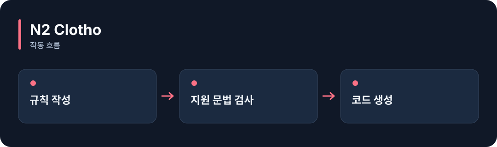

# N2 Clotho

**정해진 문법으로 적은 규칙을 검사하고, 지원하는 언어의 코드로 바꿔줍니다.**

[](https://github.com/choihyunsus/n2-clotho/releases/tag/v4.1.0) [](https://github.com/choihyunsus/n2-clotho/blob/main/docs/reference.ko.md) [](https://github.com/choihyunsus/n2-clotho/blob/main/LICENSE)

[English](README.md)



## 이런 때 사용하세요

같은 입력 검사나 상태 전환 규칙을 여러 언어의 프로그램에 적용할 때 활용하세요.

규칙은 .n2 문법으로 작성합니다. 생성한 검사 함수를 실제 작업 지점에 연결해야 적용됩니다. 언어별 지원 범위는 상세 문서에 정리되어 있습니다.

## 처음 실행하기

터미널에서 `node --version`을 실행해 Node.js 22 이상인지 확인하세요. 아래 명령은 새 연습 폴더를 만들고 GitHub 배포 파일을 설치합니다. 예제 파일과 DB도 이 폴더에 두면 경로를 따라가기 쉽습니다.

```sh
mkdir n2-clotho-demo
cd n2-clotho-demo
npm init -y
npm install https://github.com/choihyunsus/n2-clotho/releases/download/v4.1.0/n2-clotho-4.1.0.tgz
```

아래 내용을 `demo.mjs`로 저장하세요. 파일은 방금 설치 명령을 실행한 폴더에 둡니다.

```js
import { BoundedRegex } from 'n2-clotho';
const check = new BoundedRegex('^hello$', 'i');
try {
  console.log(check.test('HELLO'));
  console.log(check.test('goodbye'));
} finally {
  check.free();
}
```

```sh
node demo.mjs
```

`true`, `false`가 차례로 출력됩니다. 첫 입력은 규칙과 맞고 두 번째 입력은 맞지 않는다는 뜻이에요.

## Soul과 함께 쓰기

이 모듈은 자체 DB 없이 사용할 수 있습니다. 결과를 기억하려면 연결한 앱에서 Soul의 `n2_kv_save`를 호출해 저장하세요.

## 다음 단계와 상세 안내

[전체 사용 안내](https://github.com/choihyunsus/n2-clotho/blob/main/docs/reference.ko.md)에서 실제 앱 연결, API, 지원 범위, 복구 절차와 검증 범위를 확인할 수 있습니다. [배포 파일](https://github.com/choihyunsus/n2-clotho/releases/tag/v4.1.0)에는 설치할 버전과 변경 설명이 있습니다.

처음 나오는 용어는 이렇게 읽으면 됩니다. **MCP**는 AI 앱의 도구 연결 방식, **DB**는 저장 파일, **호스트**는 이 모듈을 연결해 실행하는 앱입니다.

사용·재배포 조건은 [라이선스](https://github.com/choihyunsus/n2-clotho/blob/main/LICENSE)를 확인하세요. 의존 모듈에는 별도 조건이 적용될 수 있으며, 상업 이용 조건은 상세 안내에 함께 설명되어 있습니다.
