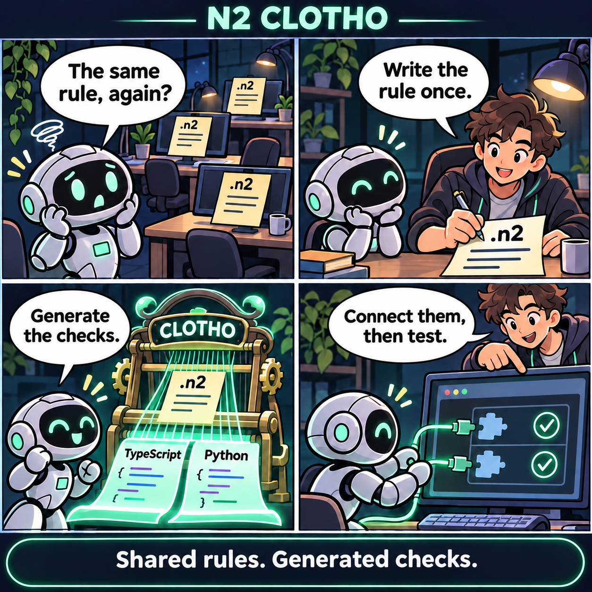
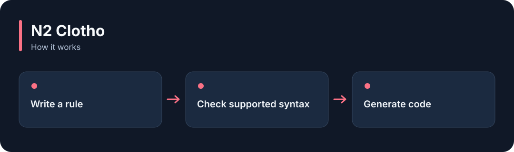

# N2 Clotho

**Check rules written in the N2 format and generate code for supported programming languages.**

[](https://github.com/choihyunsus/n2-clotho/releases/tag/v4.1.0) [](https://github.com/choihyunsus/n2-clotho/blob/main/docs/reference.md) [](https://github.com/choihyunsus/n2-clotho/blob/main/LICENSE)

[한국어](README.ko.md)

<p align="center">
  
</p>

Check rules written in the N2 format and generate code for supported programming languages.

A story illustrating the feature, rather than a screenshot of the app.

<details>
<summary>View the workflow</summary>



</details>

## When to use it

Use it when several programs need the same input checks or state-transition rules.

Rules use the .n2 syntax. Connect the generated checks to the actual operation that needs them. The reference lists the supported features for each language.

## Try it

Run `node --version` in a terminal and check for Node.js 22 or later. These commands create a fresh practice folder and install the GitHub release. Keep the example file and database in this folder.

```sh
mkdir n2-clotho-demo
cd n2-clotho-demo
npm init -y
npm install https://github.com/choihyunsus/n2-clotho/releases/download/v4.1.0/n2-clotho-4.1.0.tgz
```

Save the following as `demo.mjs` in the folder where you ran the install command.

```js
import { BoundedRegex } from 'n2-clotho';
const check = new BoundedRegex('^hello$', 'i');
try {
  console.log(check.test('HELLO'));
  console.log(check.test('goodbye'));
} finally {
  check.free();
}
```

```sh
node demo.mjs
```

`true` and then `false` appear. The first input matches the rule and the second does not.

## Using it with Soul

This module works without its own database. To remember its results, have your app save them through Soul’s `n2_kv_save` tool.

## Next steps and reference

The [full reference](https://github.com/choihyunsus/n2-clotho/blob/main/docs/reference.md) covers app integration, APIs, supported features, recovery and validation. The [release page](https://github.com/choihyunsus/n2-clotho/releases/tag/v4.1.0) contains the installable version and release notes.

A few terms used in the reference: **MCP** connects tools to an AI app, a **database** stores records, and the **host** is the app that connects and runs this module.

Review the [license](https://github.com/choihyunsus/n2-clotho/blob/main/LICENSE) for use and redistribution. Dependencies can have their own terms, including commercial-use conditions described in the reference.
